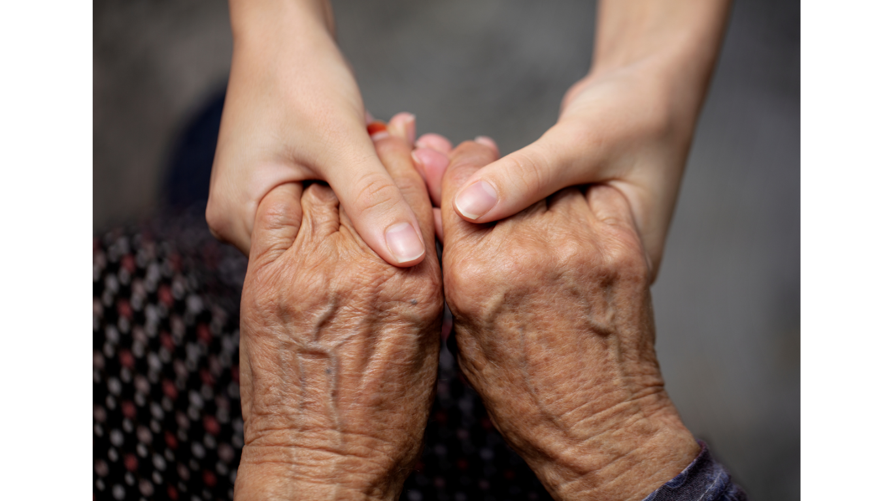

# LOG ORGANIZADO — CARTEIRA DIGITAL DE CUIDADO

**Data da conversa:** 2 de novembro de 2026  
**Assunto:** elaboração e refinamento de uma página HTML de apresentação da Carteira Digital de Cuidado.  
**Natureza do registro:** síntese organizada das decisões e código final; não é transcrição literal de todas as mensagens.

## 1. Objetivo

Criar uma página de apresentação, em HTML e CSS, para ser aberta e editada no Visual Studio Code. A página deve comunicar naturalmente a necessidade, o público, a solução e os benefícios da Carteira Digital de Cuidado, sem parecer um formulário acadêmico ou um aplicativo funcional.

## 2. Referência de conteúdo

O trabalho acadêmico mais recente apresenta a proposta como uma forma de organizar documentos e compromissos de saúde de outra pessoa. O público inclui familiares, responsáveis e cuidadores profissionais, em acompanhamentos temporários ou prolongados.

Os dois recursos centrais são:

- **Histórico e Laudos:** organizar exames, laudos, receitas e outros documentos de saúde.
- **Consultas e Profissionais:** registrar consultas, exames e tratamentos, informações dos profissionais e lembretes de datas e horários.

A frase de encerramento aprovada é: **“Mais praticidade para quem cuida, mais atenção para quem precisa.”**

## 3. Histórico das decisões

### 3.1. Primeiras versões

- Página simples, inicialmente com divisões explícitas de **Problema, Nicho, Ideia e Proposta de Valor**.
- Paleta baseada em verde-escuro, verde-claro, laranja e fundo claro.
- Uso de HTML e CSS sem JavaScript ou funcionalidades de cadastro.
- Representações de telas de celular para demonstrar o aplicativo.

### 3.2. Ajustes de tipografia e cabeçalho

- Título principal **Carteira Digital de Cuidado** em destaque e negrito.
- Em uma versão intermediária, o título foi testado em letras maiúsculas e com fonte de até 40px.
- Após analisar uma referência de diagramação enviada, foi escolhido **cabeçalho centralizado**.
- A versão final usa tipografia Helvetica/Arial e tamanho adaptável à largura da tela.

### 3.3. Fotografia

- A fotografia escolhida foi a **imagem original das mãos enviada pelo usuário**, e não imagens semelhantes geradas posteriormente.
- A foto aparece na apresentação inicial, à esquerda, com o texto **“Cuidar também é organizar.”** à direita.
- No arquivo HTML, a imagem é referenciada como `maos.png` e deve ficar na mesma pasta do `index.html`.

### 3.4. Mudança da narrativa

- Foram retirados os rótulos **Problema, Nicho, Ideia e Proposta de Valor**.
- Também foram rejeitados subtítulos explicativos genéricos como **“O desafio”**, **“Pra quem”** e **“Como funciona”**.
- A ideia deve ser apresentada por textos naturais e diretos, de forma que o leitor compreenda o contexto e a solução sem rótulos acadêmicos.
- Foi pedido para **não usar a palavra “projeto” no texto público da página**.
- A frase de abertura da parte funcional foi preservada: **“Um aplicativo que centraliza as informações de saúde em dois recursos principais:”**.
- Os textos foram ampliados um pouco para explicar melhor a solução sem ficar longos ou publicitários demais.

### 3.5. Direção visual aprovada

- Fundo branco, detalhes em laranja e verde-escuro.
- Sem ícones decorativos ou símbolos de confirmação.
- Fotografia real na abertura.
- Área de apresentação dos dois recursos do aplicativo em fundo verde muito claro.
- Dois celulares ilustrativos, com **largura igual, altura igual e proporção aproximada de 9:19,5**, evitando telas achatadas.
- Layout com rolagem vertical, responsivo, sem botões funcionais.

## 4. Estrutura final da página

1. Cabeçalho centralizado com o nome da solução e a descrição curta.
2. Fotografia original das mãos ao lado de “Cuidar também é organizar.” e texto contextual.
3. Texto “Um aplicativo que centraliza as informações de saúde em dois recursos principais:”.
4. Apresentação dos recursos “Histórico e Laudos” e “Consultas e Profissionais”.
5. Dois celulares de demonstração: navegação e agenda de novembro de 2026.
6. Dois blocos de benefícios: “Cuidar exige organização.” e “Mais facilidade no dia a dia.”
7. Encerramento com a frase aprovada.

## 5. Decisões técnicas

- Um único arquivo `index.html`, com CSS dentro de `<style>`.
- Uma imagem local `maos.png`.
- Sem dependências externas, JavaScript ou banco de dados.
- As telas de celular são elementos visuais HTML/CSS, não interfaces interativas.
- Regras de adaptação para telas menores.

## 6. Como abrir no VS Code

1. Mantenha `index.html` e `maos.png` na mesma pasta.
2. Abra essa pasta no Visual Studio Code.
3. Edite o `index.html` e salve com `Ctrl + S`.
4. Abra o arquivo HTML no navegador para conferir o resultado.

## 7. Código HTML final

O código abaixo é uma cópia exata do arquivo `index.html` incluído neste pacote, correspondente à última versão HTML preparada nesta conversa.

```html
<!DOCTYPE html>
<html lang="pt-BR">
<head>
  <meta charset="UTF-8">
  <meta name="viewport" content="width=device-width, initial-scale=1.0">
  <title>Carteira Digital de Cuidado</title>
  <style>
    * { box-sizing: border-box; }
    body { margin: 0; font-family: Helvetica, Arial, sans-serif; background: white; color: #092f22; }
    .pagina { width: 92%; max-width: 1150px; margin: auto; }
    .traco { width: 110px; height: 5px; background: #ef792e; border-radius: 10px; }
    header { text-align: center; padding: 42px 0 34px; }
    header .traco { margin: 0 auto 22px; }
    h1 { font-size: clamp(28px, 4.2vw, 48px); letter-spacing: -1.6px; margin: 0 0 12px; font-weight: 700; }
    .subtitulo { font-size: clamp(16px, 2vw, 21px); line-height: 1.5; max-width: 800px; margin: auto; color: #26313d; }
    .abertura { display: grid; grid-template-columns: 1.15fr 0.9fr; gap: 36px; align-items: center; margin-bottom: 32px; }
    .foto { display: block; width: 100%; height: 350px; object-fit: cover; border-radius: 17px; }
    .abertura .traco { width: 78px; margin-bottom: 22px; }
    h2 { font-size: clamp(29px, 3.5vw, 43px); line-height: 1.1; letter-spacing: -1px; margin: 0 0 18px; }
    p { font-size: 17px; line-height: 1.55; color: #25313b; margin: 0; }
    .abertura p { max-width: 440px; }
    .solucao { display: grid; grid-template-columns: 0.95fr 1.1fr; gap: 24px; align-items: center; background: #f3f7ed; border-radius: 32px; padding: 32px; }
    .introducao-recursos { font-size: 21px; line-height: 1.4; max-width: 390px; margin: 0 0 24px; }
    .recurso { background: #fffdf9; padding: 18px 20px 18px 24px; border-radius: 20px; margin-bottom: 13px; position: relative; }
    .recurso:before { content: ''; position: absolute; top: 19px; bottom: 19px; left: 12px; width: 4px; background: #ef792e; border-radius: 4px; }
    .recurso h3 { font-size: 24px; margin: 0 0 6px; letter-spacing: -.5px; }
    .recurso p { font-size: 15px; line-height: 1.45; }
    .celulares { display: flex; justify-content: center; gap: 16px; align-items: center; }
    .celular { width: 210px; aspect-ratio: 9 / 19.5; flex-shrink: 0; border: 5px solid #102b23; border-radius: 34px; padding: 11px 10px 16px; background: #fffdf8; box-shadow: 0 9px 14px #173c2d25; overflow: hidden; }
    .ilha { height: 15px; width: 65px; background: #102b23; border-radius: 20px; margin: 0 auto 30px; }
    .titulo-tela { font-size: 18px; font-weight: 700; line-height: 1.2; text-align: center; margin-bottom: 28px; }
    .opcao { background: #f5eee8; padding: 16px 12px; border-radius: 12px; font-size: 13px; font-weight: 600; line-height: 1.3; margin-bottom: 12px; }
    .opcao.ativa { background: #d9f0b8; }
    .agenda-titulo { font-size: 16px; font-weight: 700; text-align: center; margin-bottom: 34px; }
    .mes { font-size: 12px; text-align: center; font-weight: 700; margin-bottom: 16px; }
    .calendario { display: grid; grid-template-columns: repeat(7, 1fr); gap: 3px; text-align: center; margin-bottom: 26px; }
    .calendario span { font-size: 10px; padding: 5px 0; }
    .calendario .semana { font-size: 8px; }
    .calendario .marcado { background: #b6df75; border-radius: 6px; font-weight: 700; }
    .consulta { background: #f5eee8; border-radius: 12px; padding: 13px 10px; margin-bottom: 10px; font-size: 11px; line-height: 1.5; }
    .consulta strong { font-size: 12px; }
    .beneficios { display: grid; grid-template-columns: 1fr 1.1fr; gap: 38px; margin: 34px 0 40px; }
    .beneficios > div + div { border-left: 1px solid #d4d9d5; padding-left: 38px; }
    .beneficios h2 { font-size: 32px; margin-bottom: 12px; }
    .beneficios p { font-size: 17px; }
    footer { text-align: center; padding: 8px 0 80px; }
    footer .traco { margin: 0 auto 22px; }
    footer p { color: #092f22; font-size: clamp(24px, 3vw, 34px); font-weight: 700; line-height: 1.3; }
    @media (max-width: 950px) {
      .abertura, .solucao, .beneficios { grid-template-columns: 1fr; }
      .abertura { gap: 25px; }
      .foto { height: auto; max-height: 440px; }
      .solucao { padding: 26px; }
      .beneficios > div + div { border-left: 0; padding-left: 0; }
    }
    @media (max-width: 520px) {
      .celulares { gap: 8px; }
      .celular { width: min(43vw, 185px); border-width: 4px; padding: 9px 7px; border-radius: 25px; }
      .ilha { margin-bottom: 20px; }
      .titulo-tela { font-size: 14px; }
      .agenda-titulo { font-size: 13px; margin-bottom: 20px; }
      .opcao { font-size: 11px; padding: 11px 8px; }
      .calendario span { font-size: 8px; }
      .calendario .semana { font-size: 6px; }
      .consulta { font-size: 9px; padding: 9px 7px; }
      .consulta strong { font-size: 10px; }
      .solucao { padding: 20px 12px; }
      .beneficios h2 { font-size: 28px; }
    }
  </style>
</head>
<body>
  <main class="pagina">
    <header>
      <div class="traco"></div>
      <h1>Carteira Digital de Cuidado</h1>
      <p class="subtitulo">Organização de históricos de saúde e compromissos médicos para facilitar a rotina de quem cuida.</p>
    </header>

    <div class="abertura">
      
      <div>
        <div class="traco"></div>
        <h2>Cuidar também<br>é organizar.</h2>
        <p>Reunir documentos, exames, receitas e compromissos médicos nem sempre é simples, especialmente em tratamentos mais longos. A Carteira Digital de Cuidado nasce para tornar essa rotina mais leve, segura e organizada.</p>
      </div>
    </div>

    <div class="solucao">
      <div>
        <p class="introducao-recursos">Um aplicativo que centraliza as informações de saúde em dois recursos principais:</p>
        <div class="recurso">
          <h3>Histórico e Laudos</h3>
          <p>Organiza exames, laudos, receitas e outros documentos importantes, com acesso rápido e seguro.</p>
        </div>
        <div class="recurso">
          <h3>Consultas e Profissionais</h3>
          <p>Agenda consultas, exames e tratamentos, com informações dos profissionais de saúde e lembretes de datas e horários.</p>
        </div>
      </div>

      <div class="celulares">
        <div class="celular">
          <div class="ilha"></div>
          <div class="titulo-tela">Carteira Digital<br>de Cuidado</div>
          <div class="opcao">Histórico<br>e laudos</div>
          <div class="opcao ativa">Agenda<br>de consultas</div>
          <div class="opcao">Profissionais<br>de saúde</div>
        </div>
        <div class="celular">
          <div class="ilha"></div>
          <div class="agenda-titulo">Agenda de Consultas</div>
          <div class="mes">Novembro 2026</div>
          <div class="calendario">
            <span class="semana">SEG</span><span class="semana">TER</span><span class="semana">QUA</span><span class="semana">QUI</span><span class="semana">SEX</span><span class="semana">SÁB</span><span class="semana">DOM</span>
            <span>9</span><span>10</span><span>11</span><span class="marcado">12</span><span>13</span><span>14</span><span>15</span>
          </div>
          <div class="consulta"><strong>Consulta médica</strong><br>Qui, 12 nov · 14:00</div>
          <div class="consulta"><strong>Exame de sangue</strong><br>Sex, 13 nov · 08:00</div>
        </div>
      </div>
    </div>

    <div class="beneficios">
      <div>
        <h2>Cuidar exige<br>organização.</h2>
        <p>O acompanhamento de um tratamento, seja temporário ou contínuo, envolve diversas informações. Manter tudo reunido ajuda a evitar esquecimentos, reduz o estresse e dá mais segurança nas decisões de cuidado.</p>
      </div>
      <div>
        <h2>Mais facilidade no dia a dia.</h2>
        <p>A Carteira Digital de Cuidado oferece uma maneira simples e prática de acompanhar a saúde de quem você cuida, com informações organizadas, sempre à mão e acessíveis quando for preciso.</p>
      </div>
    </div>

    <footer>
      <div class="traco"></div>
      <p>Mais praticidade para quem cuida,<br>mais atenção para quem precisa.</p>
    </footer>
  </main>
</body>
</html>

```
